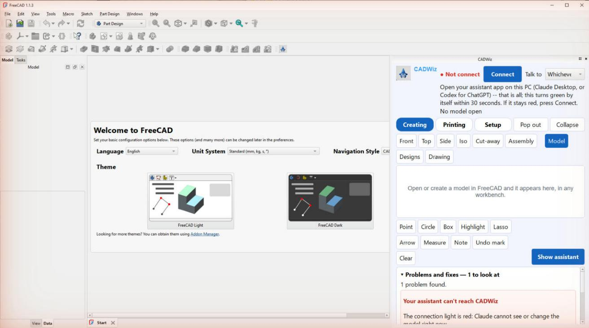

<p align="center"></p>

# CADWiz

**A smart CAD buddy for 3D-printer owners, inside FreeCAD.**

CADWiz adds a panel to FreeCAD that stays with you in every workbench. On it you
can see your model, mark on it, step back through every version you've saved, and
check the part against your own printer before you print. CADWiz works on your
real FreeCAD files. It builds ordinary, editable FreeCAD parts, backs up your file
before the first change, and never deletes anything of yours.

You tell CADWiz what you want in plain words ("make the lip 18 mm tall", "what's
the wall thickness here?", "make me a phone stand"). It works with the assistant
app **you** choose: **Claude** or **ChatGPT**. Pick one at the top of the panel,
or let CADWiz use whichever is open. CADWiz does the work in FreeCAD; the app is
just how you talk to it. CADWiz makes no paid calls of its own.



*The CADWiz panel in FreeCAD, freshly installed (real screenshot; no assistant connected yet, so the light is red).*

---

> ### 🧪 Early release: we need your help
>
> This is an **early, open-source beta**. It works, and it's used every day, but
> it hasn't met many workshops yet. **The best way to help is to use it on real
> projects and tell us what happened**: what worked, what broke, what felt
> clumsy, and what you wish it did.
>
> - **From inside CADWiz:** open the panel's **Setup** page, then **Help**.
>   **Report a problem** saves a picture of FreeCAD and what just happened, and
>   **Get help** opens the feedback page with the details filled in. Or tell your
>   assistant *"send this to the CADWiz team"*. It shows you exactly what would be
>   sent, and sends nothing without your yes.
> - **On the web:** [cadwiz.app/feedback](https://cadwiz.app/feedback). Report a
>   bug, suggest an idea or vote on others'. No GitHub account needed.
> - **If you like it,** tell us that too, and tell a friend with a 3D printer.
>   Every comment is read.

---

## Status

**v0.5.0-beta.3, early release.**

- **Works:** seeing and measuring your model; building and editing parts as
  editable FreeCAD models; pictures to choose from before anything is built;
  marks on the model; the time machine of versions; print checks for your
  printer; STL / 3MF / STEP export; technical drawing sheets; bringing in and
  repairing meshes.
- **Not yet:** FEM, CAM, architecture, surfaces and assemblies (planned for
  "CADWiz 2.0"). macOS and Linux should work but are less tested.

Full list: [known limitations](CADWiz/docs/KNOWN-LIMITATIONS.md).

## What you need

- **FreeCAD 1.1.3** (1.1 or newer): [freecad.org/downloads](https://www.freecad.org/downloads.php)
- **One assistant app, your choice:**
  - **Claude Desktop** ([claude.ai/download](https://claude.ai/download)), with a Claude subscription, **or**
  - **the ChatGPT desktop app** ([chatgpt.com/download](https://chatgpt.com/download)),
    signed in with your ChatGPT account.
- **Windows 10 or 11** is the most tested. **macOS and Linux:** help wanted.

## Install

**Windows (recommended):**
1. Download the latest `cadwiz-<version>.zip` from
   [cadwiz.app/download](https://cadwiz.app/download) and unzip it.
2. Close FreeCAD, and quit your assistant app fully: right-click its icon by the clock
   and choose **Quit** (closing its window leaves it running, and it reads CADWiz's
   settings only when it starts).
3. Double-click **`install_windows.bat`**. If FreeCAD 1.1 isn't installed, it asks
   whether to open FreeCAD's download page. It never downloads anything by itself.
   It then copies CADWiz into FreeCAD and connects CADWiz to Claude Desktop and,
   if you have it, the ChatGPT desktop app, saving a copy of each app's settings first.
   It adds **CADWiz** to the Start menu (and, if you say yes, to your desktop), and it
   lists everything it changed.
4. Click **CADWiz**. It opens FreeCAD with the CADWiz panel, together with your
   assistant app.

**To remove CADWiz:** Start menu > CADWiz > **Uninstall CADWiz** (or double-click
`uninstall_windows.bat`). It removes CADWiz, its shortcuts and its entry in your
assistant app's settings, and keeps your models and their versions.

**macOS / Linux (less tested):** unzip, then run `bash scripts/install.sh`.

**FreeCAD Addon Manager:** once CADWiz is listed, open **Tools > Addon manager**,
search for **CADWiz**, press **Install**, and restart FreeCAD. Then run the
installer once to connect your assistant app.

**By hand:** copy the `CADWiz` folder into FreeCAD's `Mod` folder, run
`"C:\Program Files\FreeCAD 1.1\bin\python.exe" -m pip install --user "mcp==1.27.0"`,
and add CADWiz to your assistant app's settings. For Claude Desktop, that's
`%APPDATA%\Claude\claude_desktop_config.json`, under `"mcpServers"`:

```json
"cadwiz": {
  "command": "C:\\Program Files\\FreeCAD 1.1\\bin\\python.exe",
  "args": ["C:\\Users\\<you>\\AppData\\Roaming\\FreeCAD\\v1-1\\Mod\\CADWiz\\src\\integrations\\cadwiz_plugin\\server.py"]
}
```

For the ChatGPT desktop app, it's `%USERPROFILE%\.codex\config.toml`:

```toml
[mcp_servers.cadwiz]
command = 'C:\Program Files\FreeCAD 1.1\bin\python.exe'
args = ['C:\Users\<you>\AppData\Roaming\FreeCAD\v1-1\Mod\CADWiz\src\integrations\cadwiz_plugin\server.py']
```

## First use

1. **Open FreeCAD.** The **CADWiz panel** appears on the right and stays there in
   every workbench.
2. **Choose your assistant** at the top of the panel: **Claude**, **ChatGPT**, or
   **Whichever app I have open**.
3. **Open that app.** Within a minute the light on the panel turns **green**. If
   it stays red, press **Connect**; CADWiz says what to check.
4. **Say what you want.** Try *"What's open in FreeCAD?"*, *"Make me a phone stand
   for my desk"*, or open a model and say *"Make this 10 mm taller"*.
5. **Point at things.** Draw on the model in the panel (point, circle, arrow...)
   and press **Show** (the button carries the name of the assistant you chose). Then say *"this"*.

The panel's **Setup** page holds your printer, your material, and how much you
want explained or asked first.

## Help, bugs and ideas

- **In CADWiz:** Setup page > Help > **Report a problem** / **Get help**, or ask
  your assistant to send it.
- **[cadwiz.app/feedback](https://cadwiz.app/feedback)**: bugs, ideas, questions
  and votes. No GitHub account needed.
- **Discord:** *link to be added.*
- **GitHub Issues**, if you use GitHub.
- **Security problems:** please report privately; see [SECURITY.md](SECURITY.md).

## Make it yours

You have the code: [docs/CUSTOMIZING.md](docs/CUSTOMIZING.md) shows how to rename
a button or add your own in one line. [CONTRIBUTING.md](CONTRIBUTING.md) says how
to send changes back.

## Licence and name

Free software under the **GNU LGPL, version 2.1 or later** ([LICENSE](LICENSE)),
the same licence family as FreeCAD. The **CADWiz name and logo are not** covered
by that licence: forks must use a different name and logo
([TRADEMARK.md](TRADEMARK.md)). Third-party parts and their licences are in
[THIRD-PARTY-NOTICES.md](THIRD-PARTY-NOTICES.md).

## Credits

Built on [FreeCAD](https://www.freecad.org), the free and open-source parametric
3D modeller, and its community. Includes the MIT-licensed freecad-robust-mcp tools
and LGPL freecad-ai code; see the notices.
